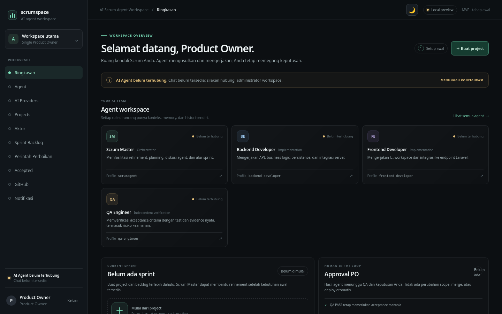
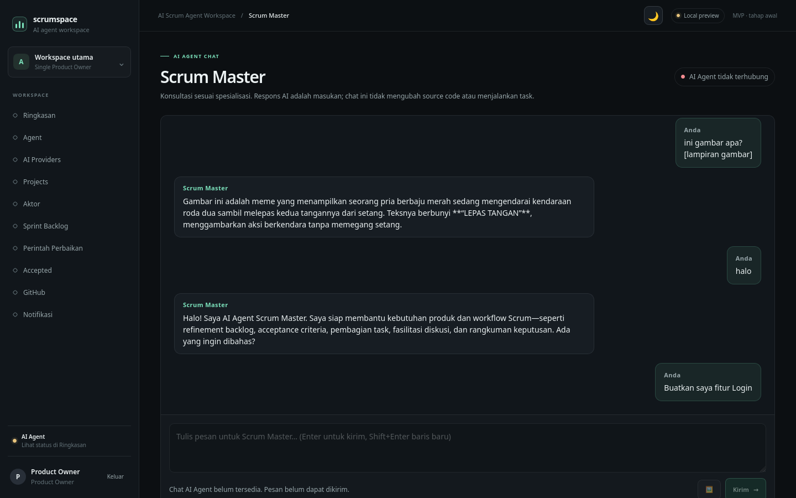

# ScrumSpace — AI Scrum Agent Workspace

Simulasi tim Scrum yang dijalankan agen AI: **Product Owner** (kamu), **Scrum Master**, dan developer **FE/BE** plus **QA Engineer**. Mulai dari estimasi Fibonacci konsensus, diskusi refinement, sampai eksekusi kode dengan QA review loop dan final acceptance — semua di satu workspace Laravel.

## Tampilan


*Ringkasan workspace: status agent AI, sprint berjalan, dan approval PO.*


*Diskusi refinement dengan Scrum Master, termasuk lampiran gambar (vision).*


## Fitur utama

**Estimasi & refinement**
- Estimasi Fibonacci konsensus: agen FE/BE/QA memberi vote, Scrum Master merangkum hasil kesepakatan (deadlock → nilai maksimum).
- Poin murni Fibonacci (1, 2, 3, 5, 8, 13) dengan pemetaan kompleksitas Ringan/Sedang/Berat.
- SM menghasilkan *refined story* terstruktur (tujuan + acceptance criteria) dari hasil diskusi; eksekusi memakai versi refined.

**Eksekusi kode oleh agen**
- Pipeline: breakdown → izin PO (sekali per eksekusi) → FE/BE mengerjakan di git worktree terisolasi → QA review (maks 2 revisi) → merge → final acceptance PO (Berhasil/Gagal mengunci story).
- Developer AI mengedit file langsung di worktree task lewat Antigravity; ScrumSpace yang membuat commit (agen tidak boleh menjalankan `git`). Bila tidak ada file yang berubah, task dicoba sekali lagi lalu berhenti dengan `AGENT_NO_CHANGES`.

**Chat dengan Scrum Master**
- Chat real-time dengan loading indicator; Enter kirim, Shift+Enter baris baru.
- Lampiran gambar (JPG/PNG ≤ 5 MB) diteruskan ke AI sebagai vision lalu dibuang — tidak tersimpan di database.
- Ketahanan AI: retry otomatis dengan backoff untuk gangguan upstream, fallback ke model cadangan, dan pesan error spesifik berbahasa Indonesia.

**AI Model (Antigravity CLI, login akun Google)**
- Semua peran (SM, BE, FE, QA) berjalan lewat [Antigravity CLI](https://antigravity.google/docs/overview/) (`agy`) dalam mode headless.
- Akun Google dihubungkan dari halaman **AI Model** (`/ai-model`): klik "Hubungkan akun Google", buka tautan, lalu tempel kodenya.
- Satu model utama untuk semua peran, dengan pilihan model khusus per peran. Daftar model diambil dari `agy models`.
- Developer BE/FE memakai profil agen `scrumspace-backend` / `scrumspace-frontend` (`resources/antigravity/agents`, disalin dengan `php artisan antigravity:sync-agents`). Izin tulis dibatasi ke worktree task; `git`, `sudo`, dan `.env` diblokir.
- Memori proyek (keputusan PO, temuan QA, riwayat git) dipasang ke worktree sebagai `.agents/rules/memori-proyek.md`. Lihat isinya dengan `php artisan memori:ekspor {project} --tampilkan`.
- Catatan: FAQ Google menyebut membungkus `agy` di dalam aplikasi "not supported" untuk paket konsumen.

## Mulai cepat (lokal)

```bash
cp .env.example .env
composer install
php artisan key:generate
php artisan migrate
php artisan serve
```

Pasang Antigravity CLI (`agy`), salin profil agen dengan `php artisan antigravity:sync-agents`, lalu hubungkan akun Google dari halaman **AI Model** dan pilih modelnya. `php artisan scrumspace:doctor` memeriksa semuanya. Login admin memakai `WORKSPACE_ADMIN_PASSWORD` di `.env`.

Di VPS, web berjalan sebagai `www-data` sedangkan login `agy` milik `sidik`, jadi `bin/agy-as-sidik` memanggil `sudo -n -u sidik agy`. Aturan sudoers-nya (`/etc/sudoers.d/scrumspace-agy`):

```
www-data ALL=(sidik) NOPASSWD: /home/sidik/.local/bin/agy
```

## Deploy ke VPS (satu perintah)

```bash
./deploy.sh
```

> **Belum diperbarui:** jalur Docker (`deploy.sh`, `docker-compose.yml`, `docs/deployment/vps-deploy.md`) masih memakai CLIProxyAPI yang sudah dihapus. Production scrum-team tidak memakai Docker; ia di-deploy lewat webhook (lihat [docs/alur-eksekusi.md](docs/alur-eksekusi.md#4-rilis)).

Script menyiapkan `.env` + `APP_KEY` otomatis, build image Docker, dan menjalankan app + worker (`docker-compose.yml`, `restart: unless-stopped`). Panduan lengkap: [docs/deployment/vps-deploy.md](docs/deployment/vps-deploy.md).

## Konfigurasi penting (.env)

| Variabel | Keterangan |
|---|---|
| `ANTIGRAVITY_BINARY` | Path `agy` (default: `agy` langsung bila PHP berjalan sebagai `sidik`, selain itu `bin/agy-as-sidik`) |
| `ANTIGRAVITY_CHAT_TIMEOUT` / `ANTIGRAVITY_TASK_TIMEOUT` | Batas waktu chat (180 dtk) dan task developer (1500 dtk) |
| `ANTIGRAVITY_CHAT_ATTEMPTS` | Jumlah percobaan chat saat gangguan sementara |
| `ANTIGRAVITY_ENABLED` | `false` mematikan semua panggilan AI |
| `WORKSPACE_ADMIN_PASSWORD` | Password akun admin |

Jangan pernah commit `.env` atau menaruh API key/token di chat maupun Git.

## Dokumentasi

- [Desain AI Team](docs/ai-team-design.md) — soul, skill, dan pemetaan model per peran
- [Konsensus Fibonacci](docs/fibonacci-consensus.md) — aturan estimasi
- [Konfigurasi Agent](docs/stage2-agent-configuration.md)
- [Deploy VPS](docs/deployment/vps-deploy.md)

## Testing

```bash
php artisan test
```

## Lisensi

MIT.

<!-- Uji webhook 2026-10-29: commit kecil untuk verifikasi update otomatis VPS (Cloudflare Tunnel path /webhook). -->
