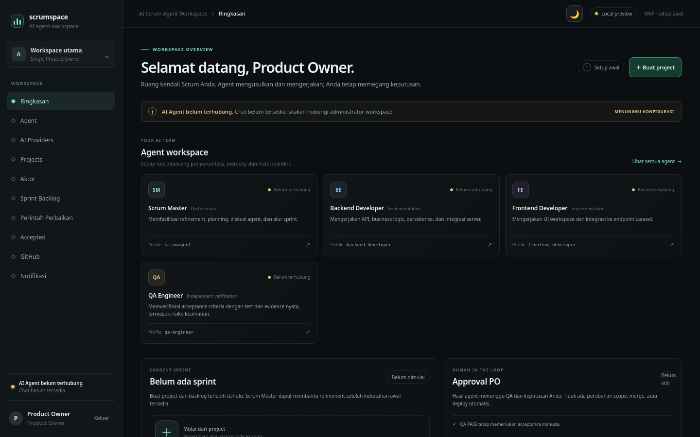
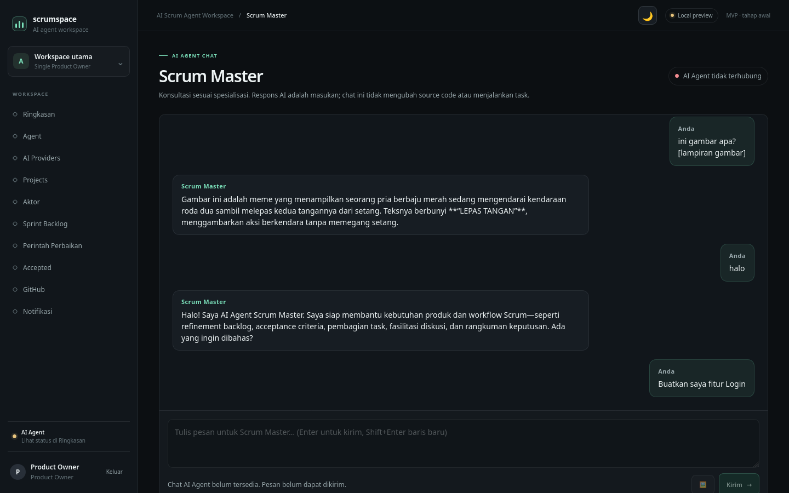
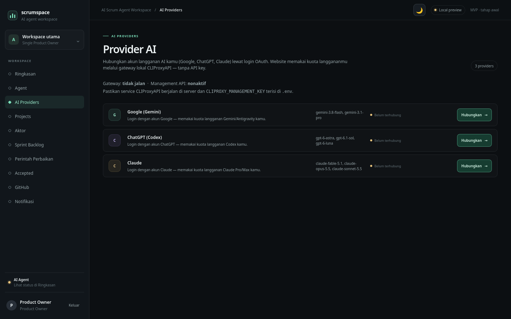

# ScrumSpace — AI Scrum Agent Workspace

Simulasi tim Scrum yang dijalankan agen AI: **Product Owner** (kamu), **Scrum Master**, dan developer **FE/BE** plus **QA Engineer**. Mulai dari estimasi Fibonacci konsensus, diskusi refinement, sampai eksekusi kode dengan QA review loop dan final acceptance — semua di satu workspace Laravel.

## Tampilan


*Ringkasan workspace: status agent AI, sprint berjalan, dan approval PO.*


*Diskusi refinement dengan Scrum Master, termasuk lampiran gambar (vision).*


*Hubungkan akun Google (Gemini), ChatGPT (Codex), dan Claude lewat OAuth — tanpa API key.*

## Fitur utama

**Estimasi & refinement**
- Estimasi Fibonacci konsensus: agen FE/BE/QA memberi vote, Scrum Master merangkum hasil kesepakatan (deadlock → nilai maksimum).
- Poin murni Fibonacci (1, 2, 3, 5, 8, 13) dengan pemetaan kompleksitas Ringan/Sedang/Berat.
- SM menghasilkan *refined story* terstruktur (tujuan + acceptance criteria) dari hasil diskusi; eksekusi memakai versi refined.

**Eksekusi kode oleh agen**
- Pipeline: breakdown → izin PO (sekali per eksekusi) → FE/BE mengerjakan di git worktree terisolasi → QA review (maks 2 revisi) → merge → final acceptance PO (Berhasil/Gagal mengunci story).
- Agen mengirim **patch JSON**; sistem yang menerapkannya (path traversal & `.git` diblokir).
- **Perintah Perbaikan**: PO memerintah dari chat SM ("perbaiki halaman login yang lambat") → SM mengklasifikasikan → kartu konfirmasi → pipeline yang sama.

**Chat dengan Scrum Master**
- Chat real-time dengan loading indicator; Enter kirim, Shift+Enter baris baru.
- Lampiran gambar (JPG/PNG ≤ 5 MB) diteruskan ke AI sebagai vision lalu dibuang — tidak tersimpan di database.
- Ketahanan AI: retry otomatis dengan backoff untuk gangguan upstream, fallback ke model cadangan, dan pesan error spesifik berbahasa Indonesia.

**AI Providers (OAuth, tanpa API key)**
- Hubungkan akun langganan **Google (Gemini)**, **ChatGPT (Codex)**, dan **Claude** lewat login OAuth dari menu AI Providers.
- Pemetaan peran: FE → Gemini, BE → Codex, QA → Claude, SM → model terpintar yang tersedia (fallback otomatis bila provider belum terhubung).
- Berjalan lewat [CLIProxyAPI](https://github.com/router-for-me/CLIProxyAPI) sebagai gateway lokal.

## Mulai cepat (lokal)

```bash
cp .env.example .env
composer install
php artisan key:generate
php artisan migrate
php artisan serve
```

Jalankan CLIProxyAPI di `127.0.0.1:8317` (lihat `CLIPROXY_*` di `.env.example`), lalu hubungkan provider dari menu **AI Providers**. Login admin memakai `WORKSPACE_ADMIN_PASSWORD` di `.env`.

## Deploy ke VPS (satu perintah)

```bash
./deploy.sh
```

Script menyiapkan `.env` + `APP_KEY` otomatis, build image Docker, dan menjalankan app + worker + CLIProxyAPI (`docker-compose.yml`, `restart: unless-stopped`). Aman dijalankan ulang untuk update. Panduan lengkap: [docs/deployment/vps-deploy.md](docs/deployment/vps-deploy.md).

## Konfigurasi penting (.env)

| Variabel | Keterangan |
|---|---|
| `CLIPROXY_BASE_URL` | URL gateway CLIProxyAPI |
| `CLIPROXY_API_KEY` | API key gateway |
| `CLIPROXY_MANAGEMENT_KEY` | Kunci Management API (untuk OAuth) |
| `CLIPROXY_CHAT_ATTEMPTS` / `CLIPROXY_CHAT_FALLBACKS` | Retry & fallback model chat AI |
| `WORKSPACE_ADMIN_PASSWORD` | Password akun admin |

Jangan pernah commit `.env` atau menaruh API key/token di chat maupun Git.

## Dokumentasi

- [Desain AI Team](docs/ai-team-design.md) — soul, skill, dan pemetaan model per peran
- [Konsensus Fibonacci](docs/fibonacci-consensus.md) — aturan estimasi
- [Konfigurasi Agent](docs/stage2-agent-configuration.md)
- [Deploy VPS](docs/deployment/vps-deploy.md)

## Testing

```bash
php artisan test
```

## Lisensi

MIT.
