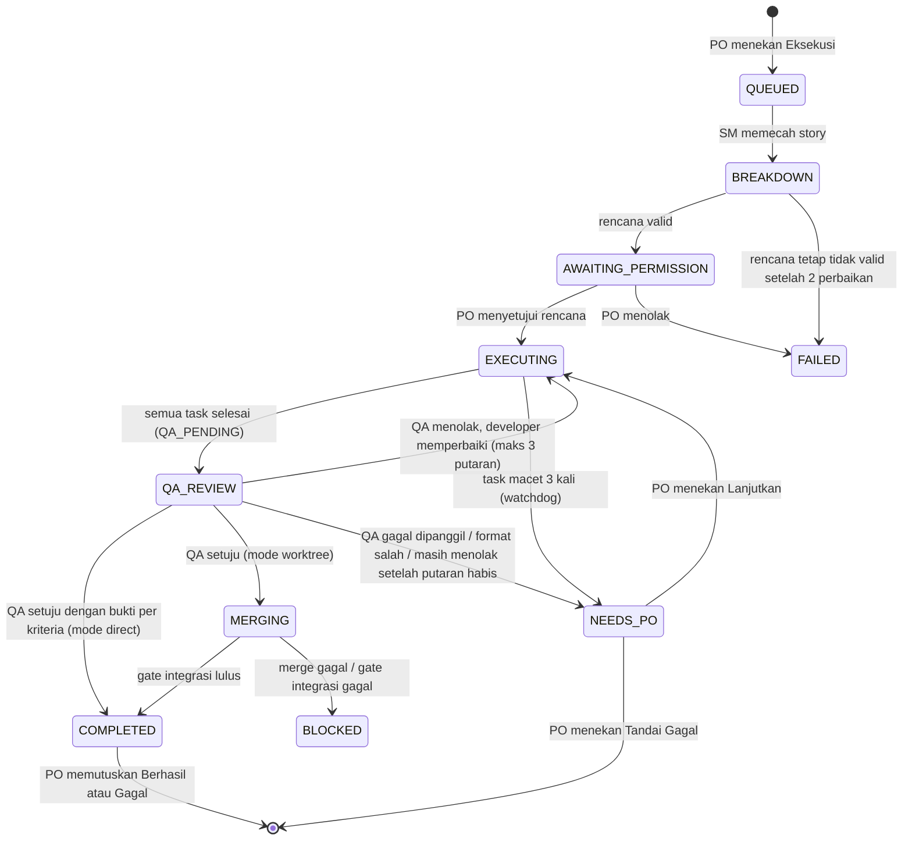

# Alur eksekusi, runbook, dan rilis

Dokumen ini menjelaskan bagaimana satu story dieksekusi tim AI (SM, FE, BE, QA), apa yang terjadi
saat run berhenti, dan bagaimana merilis atau membatalkan perubahan. Ditulis dari kode yang
berjalan; bila kode berubah, perbarui dokumen ini.

## 1. Diagram status run



Aturan yang ditegakkan di kode, bukan di prompt:

- Tidak ada persetujuan otomatis. Task hanya `APPROVED` bila QA menyertakan satu entri `criteria`
  per acceptance criteria dengan `met:true` dan `evidence`.
- Rencana SM wajib memetakan setiap acceptance criteria ke task; task yang tidak melayani criteria
  mana pun ditolak. Pemetaan ditampilkan ke PO saat menyetujui izin.
- Temuan QA dicatat per butir (`execution_findings`). Developer menjawab setiap temuan, SM menengahi
  yang diperdebatkan. Maksimal 3 putaran (`EXECUTION_QA_MAX_REPAIR_ROUNDS`).
- `NEEDS_PO` hanya bisa keluar lewat `ExecutionRun::resumeFromPo()` atau keputusan Gagal.
  Job yang masih berjalan tidak bisa menimpanya.
- Story atau perintah yang sudah diputuskan PO terkunci: run-nya tidak bisa dilanjutkan lagi.
- Mode direct: setiap run bekerja di branch sendiri `scrum/run-{id}` (titik awalnya disimpan di
  `refs/scrumspace/run-{id}-start`). Branch utama baru berubah saat PO menerima hasilnya
  (merge `--no-ff`); bila ditolak, baseline kembali ke branch utama dan hasilnya tetap bisa
  dilihat di branch run. Run berikutnya selalu berangkat dari branch utama, bukan dari run yang
  belum diputuskan. Pemulihan manual: `git checkout scrum/run-N` atau
  `git branch pulih refs/scrumspace/run-N-start`.
- Proses anak yang menjalankan kode project (demo, tes, `composer`/`npm`) tidak mewarisi rahasia
  ScrumSpace: `APP_KEY`, `DB_*`, `GITHUB_*`, `CLIPROXY_*`, dan variabel bernama
  KEY/TOKEN/SECRET/PASSWORD disaring oleh `App\Support\Projects\ProjectEnvironment`.
- Merge dikunci per run; hasil merge yang gagal diverifikasi disimpan di
  `refs/scrumspace/failed-merge-run-N` sebelum baseline dikembalikan.

## 2. Watchdog

`php artisan runs:watchdog` berjalan tiap 5 menit (`routes/console.php`). Ambang default 35 menit,
sengaja di atas batas job Hermes (30 menit) supaya pekerjaan yang sehat tidak dipotong.

| Kondisi | Tindakan |
|---|---|
| Task `IN_PROGRESS`/`IN_REVIEW` tanpa progres lewat ambang, `stall_count` < 2 | Dikembalikan ke antrean dan dikirim ulang, `stall_count` +1 |
| Task yang sama macet lagi (`stall_count` sudah 2) | Task `BLOCKED`, run `NEEDS_PO` |
| Run tanpa task berjalan tetapi masih ada task menunggu, lewat 2x ambang | Dikirim ulang; bila tak ada yang bisa dikirim, run `NEEDS_PO` |

## 3. Runbook: run berstatus NEEDS_PO

Run berhenti dengan alasan yang terbaca di banner halaman eksekusi dan di dock (pil kuning
"perlu tindakan"). Kode alasan ada di `error_code`.

| `error_code` | Artinya | Yang dilakukan |
|---|---|---|
| `WATCHDOG_STALLED` | Task macet 3 kali. Biasanya worker mati, gateway AI lambat, atau Hermes macet | 1) Cek `systemctl status scrumspace-queue cliproxy`, 2) cek `tail storage/logs/laravel.log`, 3) bila layanan sehat, tekan **Lanjutkan**; bila berulang, tandai **Gagal** dan laporkan |
| `QA_REJECTED_AFTER_REPAIR` | QA masih menolak setelah 3 putaran. Banner memuat argumen QA, developer, dan SM per temuan | Baca argumennya. Tekan **Lanjutkan** untuk jatah 3 putaran baru, atau **Tandai Gagal**, atau perbaiki kriteria story lalu jalankan ulang |
| `QA_BATCH_FAILED` | Model QA gagal dipanggil | Cek gateway/model di menu AI Providers, lalu **Lanjutkan** (QA diulang) |
| `QA_BATCH_FORMAT` | Keluaran QA tidak terbaca atau tanpa bukti per kriteria dua kali | Bila sering terjadi, ganti model QA; lalu **Lanjutkan** |
| `QA_BATCH_NO_FINDINGS` | QA menolak tanpa menyebut file/instruksi | **Lanjutkan** (QA diulang) |

Dari baris perintah:

```bash
php artisan runs:watchdog --dry-run   # lihat apa yang akan ditangani, tanpa mengubah
php artisan execution:metrics         # ringkasan per story dan velocity
```

## 4. Rilis

Push ke `main` otomatis men-deploy lewat webhook GitHub (`/opt/scrumspace-webhook/update.sh`):
backup database ke `/var/backups/scrumspace/`, `git pull --ff-only`, `composer install`,
`npm ci && npm run build`, `migrate --force`, lalu restart `scrumspace-queue`. Gagal di langkah mana
pun menghentikan update dan kode lama tetap berjalan.

Sebelum push: `vendor/bin/pint --dirty` dan `php artisan test` (di VPS, karena Hermes/OpenCode/CLIProxy
hanya ada di sana). Sesudah push: cek `curl -I https://scrum-team.artitechlabs.com/up` dan
`systemctl is-active scrumspace-queue`.

## 5. Rollback

Migrasi proyek ini bersifat menambah (kolom `stall_count`, tabel `execution_findings`), jadi kode
lama tetap bisa membaca database baru. Ini sudah dicoba: kode sebelum Fase 1 (`d5ea2e9`) dijalankan
terhadap salinan database live dan berhasil membaca run, story, dan user serta memuat rute eksekusi.

Cara memundurkan, urutan dari yang paling aman:

1. **Revert di GitHub** (disarankan, karena push men-deploy otomatis):
   `git revert <sha> && git push origin main`. Webhook men-deploy hasil revert.
2. **Mundur manual di server** (darurat; push berikutnya akan menimpa lagi):
   ```bash
   cd /opt/scrumspace
   sudo git reset --hard <sha-sebelumnya>
   sudo -u www-data php artisan optimize:clear
   sudo systemctl restart scrumspace-queue php8.5-fpm
   ```
3. **Pulihkan database** hanya bila datanya rusak: hentikan queue
   (`sudo systemctl stop scrumspace-queue`), salin cadangan terbaru dari
   `/var/backups/scrumspace/database-<waktu>.sqlite` ke `database/database.sqlite`
   (pemilik `www-data`), lalu nyalakan lagi.

## 6. Catatan operasional (audit 9 Nov 2026)

- Disk 84% (1,6 GB bebas dari 9,6 GB); RAM 2,2 GB dengan swap 1 GB. Penyumbang terbesar:
  `~/.hermes` 3,5 GB dan `/var/backups/scrumspace` 83 MB (cadangan dari tiap deploy).
- `ttyd` (7681) berjalan sebagai root di `0.0.0.0` dengan login `su - sidik`; webhook (9000) dan
  CLIProxy (8317) juga berjalan sebagai root. Dari internet publik ketiga port tidak terjangkau
  (diuji), tetapi tetap bisa dijangkau dari jaringan tunnel/Tailscale. Tidak ada firewall host
  (`ufw` tidak terpasang).
- `scheduler.log` dan `laravel.log` tidak dirotasi (belum ada konfigurasi logrotate).
